# 🧩 Word Maze — Jeu Labyrinthe de Mots

> Mini-projet d'algorithmique — application Android (Java)

Le joueur traverse un **labyrinthe généré aléatoirement**, **collecte des lettres** pour former des mots
du dictionnaire, puis rejoint la **sortie**. Le plus court chemin vers la sortie est calculé avec
l'**algorithme de Dijkstra**.

<p align="center">
  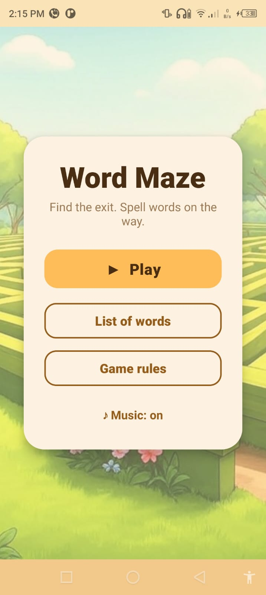
  &nbsp;&nbsp;
  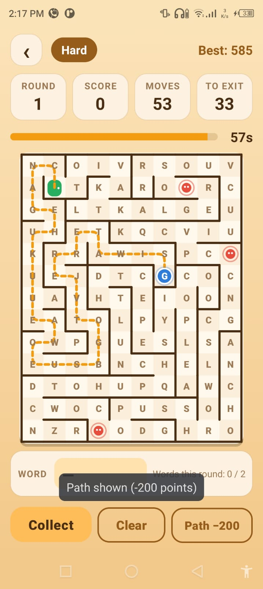
</p>

---

## Sommaire
1. [Fonctionnalités](#-fonctionnalités)
2. [Captures d'écran](#-captures-décran)
3. [Musique et sons](#-musique-et-sons)
4. [Règles du jeu](#-règles-du-jeu)
5. [Commandes](#-commandes)
6. [Algorithmes utilisés](#-algorithmes-utilisés)
7. [Structure du projet](#-structure-du-projet)
8. [Installation et lancement](#-installation-et-lancement)
9. [Lancer sur un téléphone Android](#-lancer-sur-un-téléphone-android)
10. [Générer un APK](#-générer-un-apk)
11. [Personnaliser le jeu](#-personnaliser-le-jeu)
12. [Auteurs](#-auteurs)

---

## ✨ Fonctionnalités

- Labyrinthe **parfait** (un seul chemin entre deux cases) généré à chaque manche.
- **3 niveaux de difficulté** : Easy, Medium, Hard.
- Le labyrinthe **grandit** à chaque manche gagnée (jusqu'à une taille maximale par niveau).
- **Lettres à collecter** dans chaque case ; des mots du dictionnaire sont **cachés** lettre par lettre le long des couloirs.
- **Plus court chemin** (Dijkstra) affichable contre des points.
- **Chronomètre** de 60 s (Medium / Hard).
- **Obstacles mobiles** qui se déplacent dans les couloirs (Hard).
- **Score**, **meilleur score sauvegardé** par niveau, compteur de déplacements.
- 🎵 **Musique de fond** en boucle (activable / désactivable depuis le menu) et **effets sonores**.
- Interface soignée : plateau arrondi, joueur animé, sortie pulsante, chemin en pointillés animés.

---

## 📸 Captures d'écran

### 1. Menu principal
<p align="center">
  
</p>
<p align="center">Écran d'accueil avec les boutons <b>Play</b>, <b>List of words</b>, <b>Game rules</b> et le bouton <b>♪ Music</b> pour activer ou couper la musique de fond.</p>

### 2. Choix de la difficulté
<p align="center">
  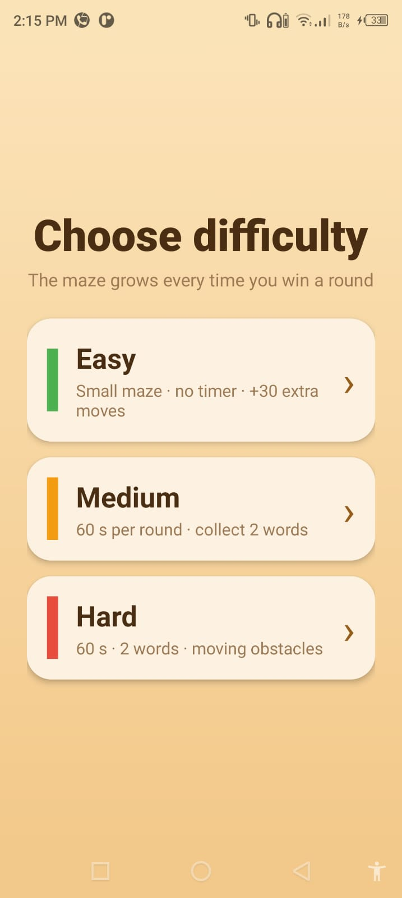
</p>
<p align="center">Trois niveaux : <b>Easy</b> (pas de chrono), <b>Medium</b> (60 s, 2 mots à trouver) et <b>Hard</b> (60 s, 2 mots, obstacles mobiles).</p>

### 3. Mode Easy — début de partie
<p align="center">
  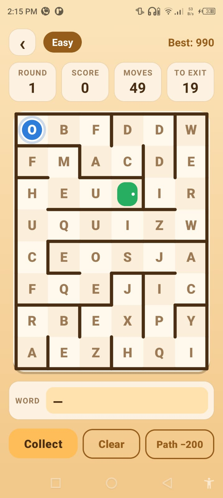
</p>
<p align="center">Le joueur (boule bleue) doit rejoindre la sortie (porte verte). En haut : la manche, le score, les déplacements restants et la distance jusqu'à la sortie.</p>

### 4. Mode Easy — mot trouvé
<p align="center">
  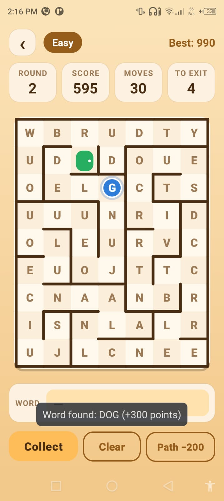
</p>
<p align="center">Le joueur a ramassé les lettres <b>D</b>, <b>O</b>, <b>G</b> dans l'ordre : le mot <b>DOG</b> est validé (+300 points, 100 par lettre).</p>

### 5. Mode Easy — sortie atteinte
<p align="center">
  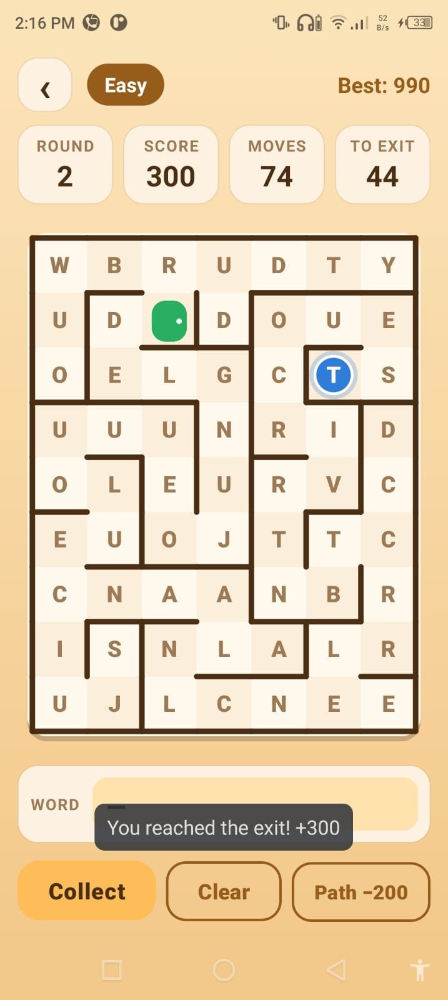
</p>
<p align="center">La sortie est atteinte (+300 points) : un nouveau labyrinthe, plus grand, est généré pour la manche suivante.</p>

### 6. Mode Medium — plus court chemin affiché
<p align="center">
  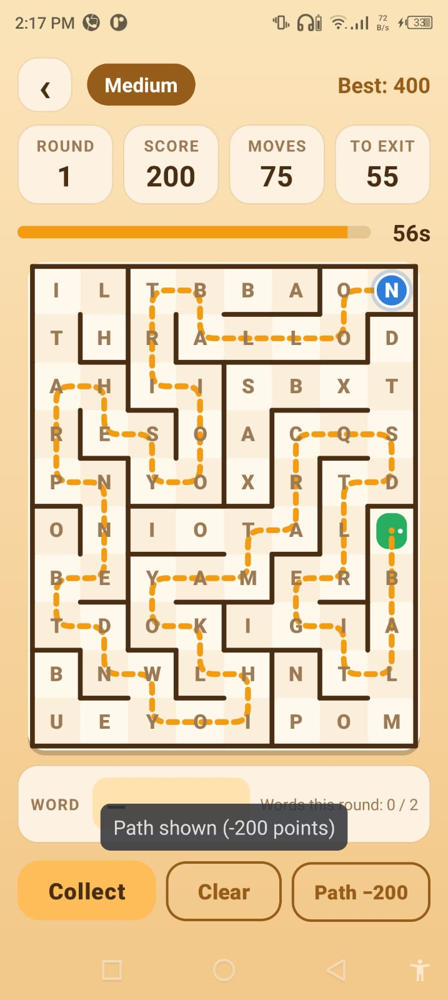
</p>
<p align="center">Avec le bouton <b>Path −200</b>, le plus court chemin calculé par l'algorithme de <b>Dijkstra</b> s'affiche en pointillés orange. La barre de temps indique les secondes restantes.</p>

### 7. Mode Hard — début de partie
<p align="center">
  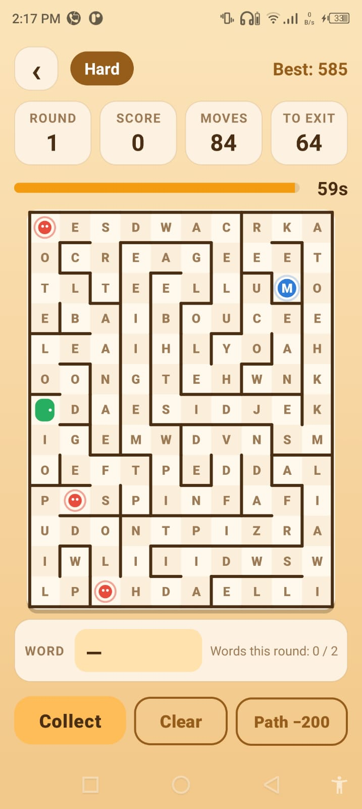
</p>
<p align="center">Labyrinthe plus grand avec des <b>obstacles mobiles</b> (boules rouges) qui se déplacent dans les couloirs.</p>

### 8. Mode Hard — plus court chemin affiché
<p align="center">
  
</p>
<p align="center">Le chemin le plus court jusqu'à la sortie, recalculé à chaque déplacement du joueur.</p>

### 9. Mode Hard — manche rejouée
<p align="center">
  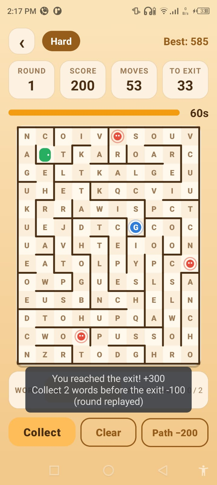
</p>
<p align="center">Le joueur a atteint la sortie sans avoir trouvé 2 mots : −100 points et la manche est rejouée.</p>

### 10. Règles du jeu
<p align="center">
  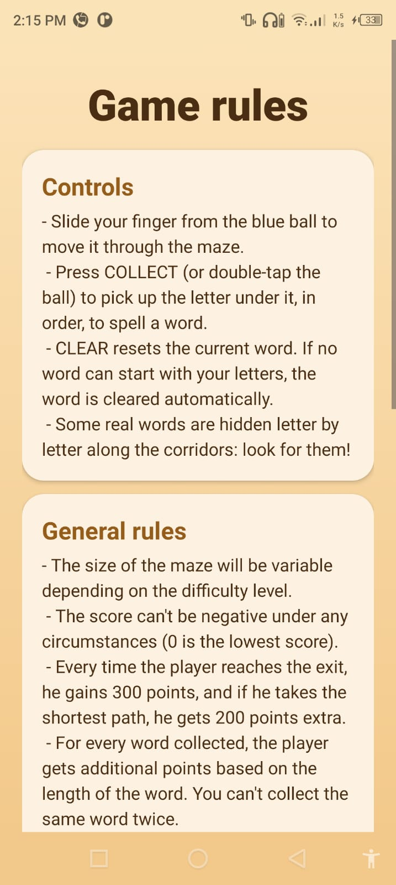
</p>
<p align="center">Les commandes et les règles générales.</p>

### 11. Règles par niveau
<p align="center">
  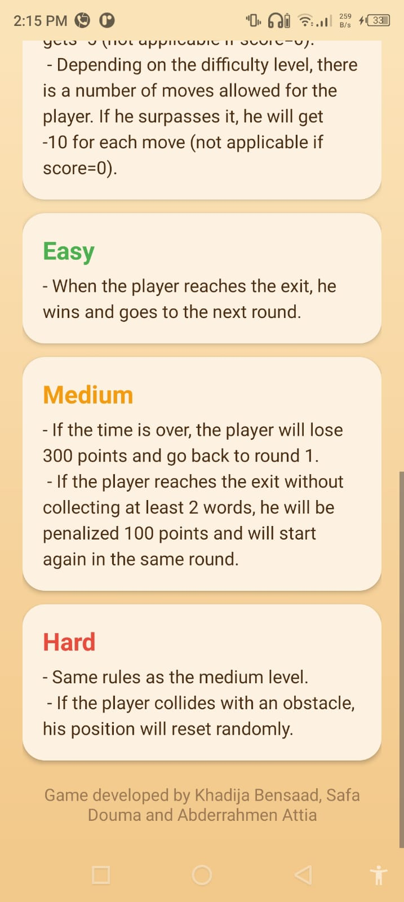
</p>
<p align="center">Les règles spécifiques aux niveaux Easy, Medium et Hard.</p>

### 12. Liste des mots
<p align="center">
  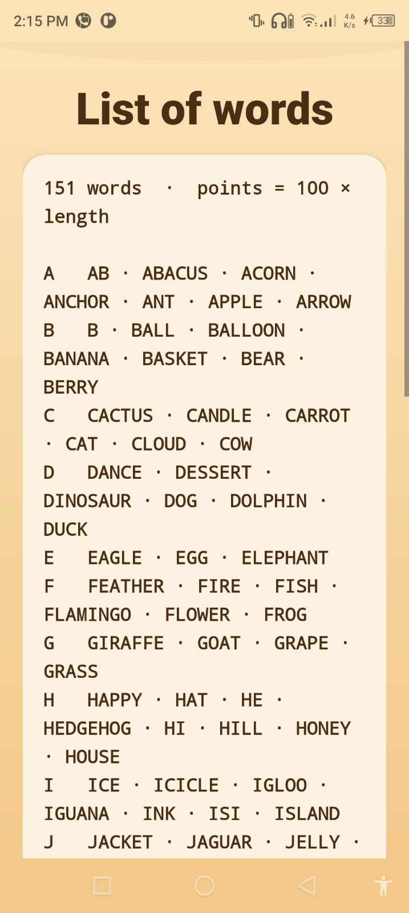
</p>
<p align="center">Tous les mots du dictionnaire, triés par ordre alphabétique et groupés par première lettre.</p>

---

## 🎵 Musique et sons

Le jeu contient de l'audio (fichiers dans `app/src/main/res/raw/`) :

| Fichier | Quand |
|---|---|
| `bakcground_music.mp3` | Musique de fond, jouée en boucle pendant tout le jeu |
| `word_found.mp3` | Son joué quand un mot valide est trouvé |
| `victory.mp3` | Son joué quand le joueur atteint la sortie |

- La musique peut être **coupée / réactivée** avec le bouton **♪ Music** du menu principal.
- Elle se met **en pause** quand l'application passe en arrière-plan.

---

## 📜 Règles du jeu

### Règles générales
| Action | Points |
|---|---|
| Atteindre la sortie | **+300** |
| Atteindre la sortie par le plus court chemin exact | **+200** (bonus) |
| Former un mot valide | **+100 × nombre de lettres** (ex. `TIGER` = +500) |
| Afficher le plus court chemin (une fois par manche) | **−200** (nécessite au moins 200 points) |
| Revenir sur la case précédente | **−5** |
| Chaque déplacement au-delà du nombre autorisé | **−10** |

- Le score ne peut **jamais être négatif** (minimum 0).
- Un même mot ne peut être collecté **qu'une seule fois** par partie.
- Nombre de déplacements autorisés = plus court chemin **+ 30** (Easy) ou **+ 20** (Medium / Hard).

### Easy
- Pas de chronomètre. Atteindre la sortie fait passer à la manche suivante.
- Taille : 6 × 8 au départ, jusqu'à 10 × 13.

### Medium
- **60 secondes** par manche. Temps écoulé → **−300 points** et retour à la manche 1.
- Il faut **collecter au moins 2 mots** avant la sortie, sinon **−100 points** et la manche est rejouée.
- Taille : 8 × 10 au départ, jusqu'à 13 × 17.

### Hard
- Mêmes règles que Medium.
- **Obstacles mobiles** (boules rouges) : les toucher renvoie le joueur à une position aléatoire.
- Taille : 10 × 13 au départ, jusqu'à 16 × 21.

---

## 🎮 Commandes

| Geste / bouton | Effet |
|---|---|
| Glisser le doigt depuis la boule bleue | Déplace le joueur case par case (les murs bloquent) |
| **Collect** ou double-tap sur la boule | Ramasse la lettre de la case actuelle |
| **Clear** | Efface le mot en cours |
| **Path −200** | Affiche le plus court chemin jusqu'à la sortie |
| **‹** | Retour au menu |

Les lettres doivent être ramassées **dans l'ordre** du mot. Si aucun mot du dictionnaire ne commence
par les lettres ramassées, le mot est effacé automatiquement.

**Légende du plateau :** 🔵 joueur · 🟩 sortie · 🔴 obstacle · cases jaunes = lettres du mot en cours ·
pointillés orange = plus court chemin.

---

## 🧠 Algorithmes utilisés

### 1. Génération du labyrinthe — *Recursive Backtracking* (DFS itératif)
Fichier : `GameViews.java` → `createMaze()`, `getNeighbour()`, `removeWall()`

1. Toutes les cases commencent avec leurs 4 murs.
2. On part de la case du joueur, marquée « visitée ».
3. Tant qu'il reste des cases à explorer :
   - si la case courante a un voisin non visité, on en choisit un **au hasard**, on **supprime le mur**
     entre les deux, on **empile** la case courante et on avance ;
   - sinon on **dépile** (retour arrière).

Résultat : un labyrinthe **parfait** (arbre couvrant), donc toujours un chemin unique vers la sortie.
Complexité : **O(L × C)** en temps et en mémoire (L lignes, C colonnes).

### 2. Plus court chemin — *Dijkstra*
Fichier : `GameViews.java` → `dijkstra()`, `getNeighbors()`

- Graphe : chaque case est un sommet, une arête relie deux cases adjacentes **sans mur** (poids 1).
- File de priorité (`PriorityQueue`) triée par distance, tableau des prédécesseurs pour reconstruire le chemin.
- Le chemin est recalculé après chaque déplacement du joueur (affichage « To exit »).

Complexité : **O(V log V)** avec V = L × C (le graphe a au plus 4 arêtes par sommet).
Comme tous les poids valent 1, un parcours en largeur (BFS) donnerait le même résultat ;
Dijkstra est utilisé ici dans un but pédagogique.

### 3. Placement des mots
Fichier : `GameViews.java` → `plantWords()`, `findWalk()`

Pour que les mots soient réellement trouvables, quelques mots du dictionnaire (2 en Easy, 3 en Medium,
4 en Hard) sont écrits lettre par lettre le long d'un **chemin simple** dans les couloirs
(marche aléatoire sans revisiter de case, en évitant la sortie et les autres mots).
Les autres cases reçoivent des lettres aléatoires, pondérées selon leur fréquence en anglais.

### 4. Validation des mots
- Le dictionnaire est chargé dans un `HashSet` → recherche en **O(1)**.
- Tous les **préfixes** des mots sont aussi stockés : on sait immédiatement si les lettres ramassées
  peuvent encore former un mot.

---

## 📁 Structure du projet

```
Maze-Game-Projet-algo-main/
├── build.gradle.kts                  # Config Gradle globale (version du plugin Android)
├── settings.gradle.kts               # Nom du projet, module :app, dépôts
├── gradle.properties                 # Options Gradle (AndroidX, mémoire)
├── gradle/wrapper/                   # Gradle Wrapper (version de Gradle utilisée)
├── gradlew / gradlew.bat             # Lancer Gradle en ligne de commande
├── docs/                             # Captures d'écran utilisées dans ce README
└── app/
    ├── build.gradle.kts              # Config du module : SDK, dépendances
    └── src/main/
        ├── AndroidManifest.xml       # Déclaration des écrans (activités)
        ├── java/com/example/test_labyrinthe/
        │   ├── MainActivity.java     # Menu principal + musique de fond
        │   ├── Difficulty.java       # Choix du niveau
        │   ├── GameView.java         # Écran de jeu : HUD, boutons, pause/reprise
        │   ├── GameViews.java        # ⭐ Logique du jeu + dessin du labyrinthe
        │   ├── GameRules.java        # Écran des règles
        │   └── ListOfWords.java      # Écran de la liste des mots
        └── res/
            ├── layout/               # Interfaces XML de chaque écran
            ├── values/               # Couleurs, textes (règles), thème et styles
            ├── drawable/             # Fonds, formes arrondies, images
            └── raw/
                ├── dictionary.txt    # ⭐ Mots à collecter (un par ligne)
                ├── bakcground_music.mp3
                ├── victory.mp3
                └── word_found.mp3
```

### Rôle des classes principales

**`GameViews`** (vue personnalisée, hérite de `View`)
- `setDimensions(diff)` : démarre une partie selon le niveau.
- `createMaze()` : génère le labyrinthe, place joueur, sortie, lettres, mots, obstacles, lance le chrono.
- `movePlayer()` : déplacement, pénalités, recalcul du chemin, collisions, sortie.
- `collectCurrentLetter()`, `clearWord()`, `checkWord()` : gestion des mots.
- `calculatePath()` : affichage payant du plus court chemin.
- `onDraw()` : dessin du plateau, des lettres, des murs, du joueur, de la sortie, des obstacles et du chemin.
- `onTouchEvent()` : glissement et double-tap.
- `pause()` / `resume()` : met le chrono et les obstacles en pause quand l'application est en arrière-plan.
- Interface `GameListener` : envoie le score, la manche, le temps, etc. à l'écran de jeu.

**`GameView`** (activité) : relie la vue du labyrinthe au panneau d'infos et aux boutons.

---

## 🛠 Installation et lancement

### Prérequis
- **Android Studio** Giraffe (2022.3) ou plus récent — https://developer.android.com/studio
- Le JDK est fourni avec Android Studio : rien à installer.
- Connexion Internet au premier lancement (téléchargement des dépendances Gradle).

| Élément | Version |
|---|---|
| Android Gradle Plugin | 8.1.4 |
| Gradle | 8.7 |
| compileSdk / targetSdk | 34 (Android 14) |
| minSdk | 24 (Android 7.0) |
| Langage | Java 11 |

### Étapes
1. **Cloner** le dépôt (ou télécharger le ZIP depuis GitHub puis l'**extraire**) :
   ```bash
   git clone https://github.com/<votre-compte>/<votre-depot>.git
   ```
   > Android Studio ne peut pas ouvrir un projet directement dans un fichier `.zip` : il faut l'extraire.
2. Android Studio → **File › Open…** → choisir le dossier qui contient `settings.gradle.kts`
   (pas le dossier `app`).
3. Cliquer **Trust Project**.
4. Attendre la fin de la **synchronisation Gradle** (barre en bas, quelques minutes la première fois).
   - « Failed to find target android-34 » → cliquer **Install missing SDK**
     (ou **Tools › SDK Manager** → installer *Android 14 (API 34)*).
5. Choisir un appareil en haut (émulateur ou téléphone), vérifier que **app** est sélectionné,
   puis cliquer **▶ Run** (Maj+F10).

Pour créer un émulateur : **Tools › Device Manager › Create Device** → Pixel → image système API 34.

---

## 📱 Lancer sur un téléphone Android

Le jeu fonctionne sur tout téléphone avec le système d'exploitation **Android 7.0 ou plus récent**.

1. **Settings › About phone** → taper **7 fois** sur **Build number** pour activer le mode développeur
   (le nom exact du menu peut varier selon la marque ; utilisez la recherche des paramètres : « Build number »).
2. **Settings › System › Developer options** → activer **USB debugging**.
3. Brancher le téléphone en USB, choisir **File transfer**, puis accepter **Allow USB debugging**.
4. Dans Android Studio, sélectionner le téléphone en haut, puis cliquer **▶ Run**.

---

## 📦 Générer un APK

Dans Android Studio : **Build › Build Bundle(s) / APK(s) › Build APK(s)**.

Ou en ligne de commande :
```bash
./gradlew assembleDebug        # Windows : gradlew.bat assembleDebug
```
APK généré : `app/build/outputs/apk/debug/app-debug.apk` (à copier sur un téléphone pour l'installer).

---

## 🔧 Personnaliser le jeu

| Ce que vous voulez changer | Où |
|---|---|
| Ajouter / retirer des mots | `app/src/main/res/raw/dictionary.txt` (un mot par ligne, lettres A–Z) |
| Taille des labyrinthes | `GameViews.java` → `baseDimensions()` et `maxDimensions()` |
| Durée du chrono | `GameViews.java` → `ROUND_TIME` |
| Nombre de mots cachés | `GameViews.java` → `plantWords()` (variable `wanted`) |
| Couleurs de l'interface | `res/values/colors.xml` |
| Couleurs du labyrinthe | `GameViews.java` → `init()` |
| Texte des règles | `res/values/strings.xml` |

---

## 👥 Auteurs

Projet réalisé par **Khadija Bensaad**, **Safa Douma** et **Abderrahmen Attia**
dans le cadre du mini-projet d'algorithmique.
